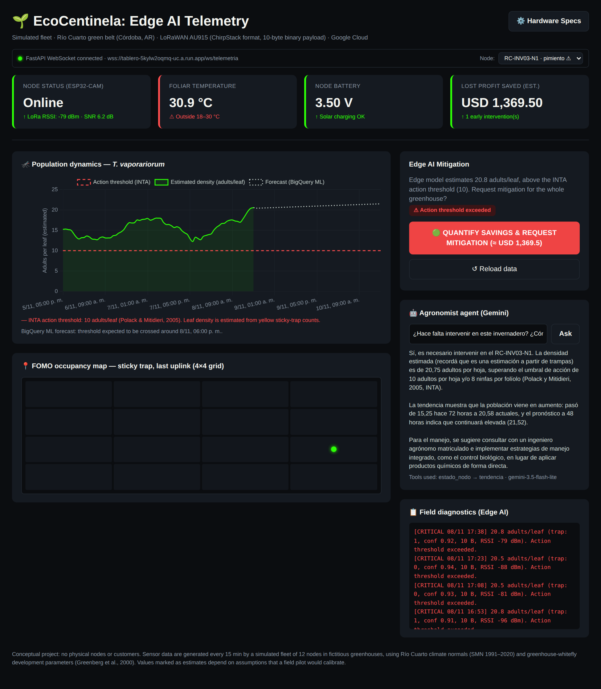
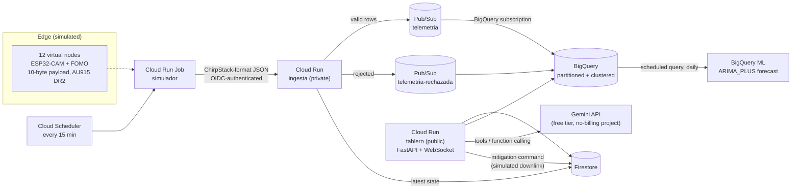

# EcoCentinela on Google Cloud

**Simulated LoRaWAN + Edge AI whitefly monitoring for greenhouse horticulture in Río Cuarto (Córdoba, Argentina), deployed end-to-end on Google Cloud within the free tier.**

> **Conceptual project.** There are no physical nodes and no customers. A fleet of 12 virtual sensor nodes in fictitious greenhouses transmits every 15 minutes, driven by Río Cuarto climate normals and published whitefly biology. The cloud side is real, though: real services, real infrastructure as code, real CI/CD, real monitoring.

**Live dashboard:** https://tablero-5kylw2oqmq-uc.a.run.app



---

## What it does

An optical node (ESP32-CAM) photographs a yellow sticky trap. A TinyML model (FOMO) counts adult greenhouse whiteflies (*Trialeurodes vaporariorum*) on the device, and the node sends a **10-byte** LoRaWAN uplink. In the cloud, the platform:

1. ingests the uplinks in the same JSON format as a ChirpStack v4 HTTP integration,
2. validates them and stores them,
3. estimates pest density (adults per leaf) from a rolling 24-hour trap window,
4. compares it with the **INTA action threshold** (10 adults/leaf; Polack & Mitidieri, 2005),
5. forecasts the next 48 h with BigQuery ML, and
6. quantifies the loss avoided by intervening early.

## Architecture



**Platform:** Terraform (remote state in GCS) · GitHub Actions with **Workload Identity Federation** (no keys) · Cloud Build · Artifact Registry with a cleanup policy · Secret Manager · Cloud Monitoring (uptime check, log-based metrics, alert policies, dashboard) · Budget alerts with an **automatic billing kill switch**.

## Engineering decisions

| Decision | Why |
|---|---|
| **10-byte binary payload** instead of 54-byte JSON | Argentina uses the AU915 plan. At DR2 (SF10/125 kHz), LoRaWAN RP002-1.0.3 (table 45) allows **11 bytes** with the 400 ms dwell time that devices must assume at boot, or 51 bytes without it. The original JSON did not fit either case. |
| Count on a **yellow sticky trap** instead of on leaves | A fixed camera cannot see the underside of leaves, where adults sit. Sticky traps are the standard monitoring tool, and camera-based counting on traps is well documented. |
| **Rolling 24 h window**, provisional for the first 12 h | A single 15-minute window holds only 0–2 captures, so it is pure noise. |
| **Pub/Sub → BigQuery subscription** (no Dataflow) | Writes directly to BigQuery with no code or workers, and stays within the free tier. Dataflow would be the choice for complex streaming transforms. |
| **BigQuery ML ARIMA_PLUS** instead of an LSTM | It handles short hourly series, trains in seconds, runs serverless with SQL, and gives one model per node with `time_series_id_col`. |
| **Cloud Run** scales to zero; `max_instances` capped | No traffic costs nothing, and a public page cannot run up a bill. |
| WebSocket sessions closed after 10 min | An open WebSocket keeps a Cloud Run instance billable. |
| Budget measures **gross cost** (`EXCLUDE_ALL_CREDITS`) | During the free trial, credits make net cost zero, so a net-cost budget would never fire. |
| `us-central1` | One of the three regions where Cloud Storage's free tier applies. Latency does not matter for 15-minute telemetry. |
| Gemini on a **separate project without billing** | The free tier of the Gemini API can never generate charges there. |

## Numbers

- **Load test (Kubernetes, local kind cluster):** 500 uplinks in 3.5 s (144/s), p95 212 ms, 100 % accepted.
- **Load test (Cloud Run, 1,000 virtual nodes):** 1,000/1,000 accepted at 50/s; p50 113 ms, p95 770 ms, p99 5.3 s (cold start of the second instance under the `max_instances = 2` cost cap). About 45,000 uplinks per 15-minute window, roughly 3,800 times the fleet's real load.
- **History:** 30 days × 12 nodes × 96 uplinks/day = 34,560 rows, loaded with free batch load jobs.
- **Data migration:** legacy SQLite (from the original proof of concept) → BigQuery, reconciled by row count and checksum.

## Repository layout

```
common/ecocentinela/   payload codec, agronomic + economic model, ChirpStack event format
services/ingesta/      FastAPI ingestion API (Cloud Run, private)
services/tablero/      FastAPI + WebSocket dashboard and Gemini agent (Cloud Run, public)
services/simulador/    virtual fleet: normal / 30-day history / load-test modes (Cloud Run Job)
services/corte/        billing kill switch (Pub/Sub push → Cloud Billing API)
infra/terraform/       all infrastructure as code
sql/                   BigQuery views (dedup, data quality) and the ARIMA_PLUS training query
k8s/                   Kubernetes manifests + script to run them on kind
migracion/             SQLite → BigQuery migration with reconciliation
tests/                 pytest suite (runs in CI and inside Cloud Build)
```

## Run it yourself

```bash
python -m venv .venv && . .venv/bin/activate
pip install -r services/ingesta/requirements.txt -r services/tablero/requirements.txt pytest httpx
python -m pytest -q tests                 # unit tests
./k8s/probar_en_kind.sh                   # local Kubernetes + load test
```

To deploy to a new project: create a GCS bucket for the Terraform state, build the images with `gcloud builds submit --config cloudbuild.yaml`, then `terraform init -backend-config=bucket=<bucket>` and `terraform apply`.

## Sources

- LoRa Alliance, *LoRaWAN Regional Parameters RP002-1.0.3* (2021), AU915-928, table 45.
- ENACOM, Resolutions 551/2021 and 280/2022 (915–928 MHz low-power devices).
- Servicio Meteorológico Nacional, *Estadísticas climatológicas normales 1991–2020*, Río Cuarto Aero.
- Greenberg, Legaspi, Jones & Enkegaard (2000), *Environmental Entomology* 29(4):851-860: *T. vaporariorum* base temperature of 2.92 °C and 483.4 degree-days from egg to adult.
- Polack & Mitidieri (2005), INTA San Pedro: action threshold of 10 adults/leaf and/or 8 nymphs/leaflet.
- Scotta, Sánchez & Arregui (2014), *FAVE Sección Ciencias Agrarias* 13(1), UNL: 60–80 % commercial yield loss from sooty mould.

Values that are illustrative assumptions (greenhouse temperature offset, reproduction rate, trap-to-leaf calibration, crop value at risk) are labelled `[SUPUESTO]` in `common/ecocentinela/modelo.py`. A field pilot would calibrate them.
