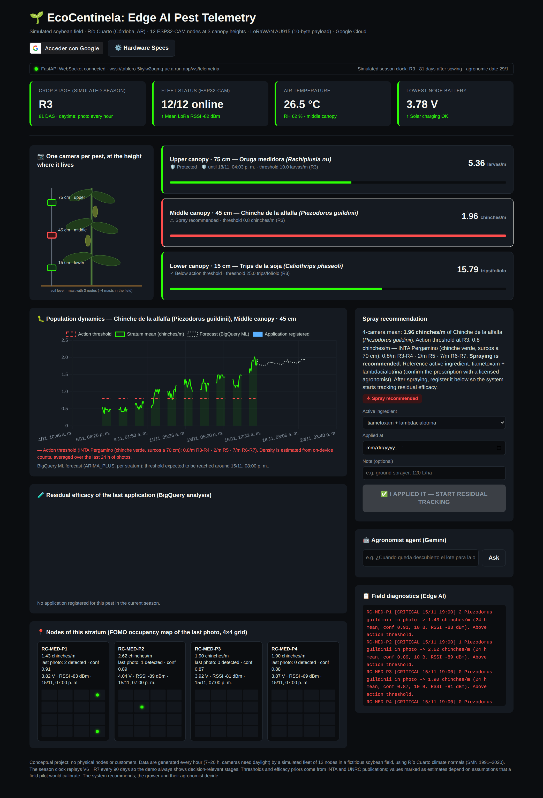
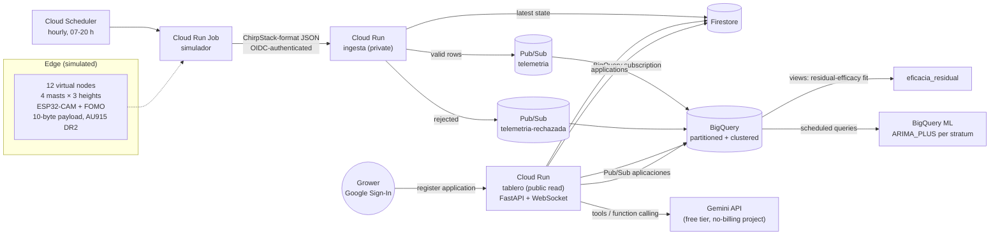

# EcoCentinela on Google Cloud

**Edge AI + LoRaWAN pest monitoring for a soybean field near Río Cuarto (Córdoba, Argentina): 12 cameras at three canopy heights, spray recommendations, and residual-efficacy tracking in BigQuery. Deployed end-to-end on Google Cloud within the free tier.**

> **Conceptual project.** There are no physical nodes and no customers. A fleet of 12 virtual camera nodes in a fictitious soybean field sends one photo count per hour during daylight, driven by Río Cuarto climate normals and published pest biology. The cloud side is real, though: real services, real infrastructure as code, real CI/CD, real monitoring. It continues the EcoCentinela proof of concept that reached the Red Bull Basement 2026 national final.

**Live dashboard (read-only for visitors):** https://tablero-5kylw2oqmq-uc.a.run.app



---

## What it does

Soybean is the main crop around Río Cuarto, and three of its key pests live at **different heights of the plant**. A single camera cannot watch all of them. Each of the 4 masts in the field therefore carries **3 ESP32-CAM nodes**, and each node specialises in one pest:

| Stratum | Camera height | Pest | Why there | Action threshold (reference) |
|---|---|---|---|---|
| Upper | 75 cm | Soybean looper, *Rachiplusia nu* | Lives in the upper canopy (Insects 2025, 16(4):365) | >20 larvae/m (vegetative), >10 larvae/m (reproductive); Iannone, INTA |
| Middle | 45 cm | Redbanded stink bug, *Piezodorus guildinii* | Nymphs sit "in the middle and lower strata" (Massaro & Gonsebatt, INTA Oliveros); 70–82 % of egg masses below the top 35 cm (Temple et al. 2016) | 0.8/m R3–R4, 2/m R5, 7/m R6–R7; INTA Pergamino |
| Lower | 15 cm (macro on a lower leaflet) | Soybean thrips, *Caliothrips phaseoli* | Colonies "preferably on the lower leaves" (Alonso, INTA Balcarce 2023) | 25 thrips/leaflet at R5 (Gamundi et al. 2006); no official threshold exists |

The flow is the same for every node: **take a photo → count the pest on the device with a TinyML model (FOMO) → send only the count in a 10-byte LoRaWAN uplink.** The photo never leaves the node. In the cloud, the platform:

1. ingests the uplinks in the same JSON format as a ChirpStack v4 HTTP integration, validates and stores them;
2. turns per-photo counts into density in agronomic units (24 h mean of valid photos) and averages the 4 cameras of each stratum;
3. compares each stratum with its stage-dependent action threshold and **recommends spraying** when it is exceeded and no protection is active;
4. lets the grower **register the application** (Google Sign-In, allowlisted accounts only); from then on the system tracks the product's **residual efficacy** and estimates when the field will be **uncovered**;
5. learns the real decay from the field data in **BigQuery**, which replaces the literature prior after 3 days of data;
6. forecasts each stratum 72 h ahead with BigQuery ML, and answers questions through a Gemini agent with function calling.

The system recommends; the grower and their agronomist decide. Products are named by active ingredient, never by brand or dose.

## Residual efficacy: from the literature to the field

Efficacy decays exponentially after an application: **E(t) = E0 · e^(−k·t)**. The field is considered *uncovered* when E < 50 % (configurable).

* **Prior** (before field data): from published trials. For example, INTA Oliveros measured thiamethoxam + lambda-cyhalothrin on *P. guildinii* adults at 89, 84, 38, 82 and 58 % efficacy on days 2, 3, 6, 10 and 14 (Perotti, Gamundi & Russo 2010); a least-squares fit gives E0 = 0.78 and k = 0.0216/day.
* **Field fit** (BigQuery, `sql/eficacia_puntos.sql` + `sql/eficacia_residual.sql`): there is no untreated plot, so the query builds a **virtual untreated control** from the log-linear pest trend in the 72 h before spraying. Observed efficacy follows the Henderson-Tilton idea, E_obs = 1 − N_observed / N_control. The query then fits ln E = ln E0 − k·t by least squares and returns the half-life, R² and the estimated uncovered date.
* In the demo season, chlorantraniliprole on the looper has a 14-day half-life in the literature. The field data says **9.6 days (R² 0.88)**, so BigQuery moves the uncovered date **4 days earlier**. The simulator's ground truth is 10 days, which shows that the analysis recovers it.

## Architecture



**Platform:** Terraform (remote state in GCS) · GitHub Actions with **Workload Identity Federation** bound to the repository ID (no keys) · Cloud Build · Artifact Registry with a cleanup policy · Secret Manager · Cloud Monitoring (uptime check, log-based metrics, alert policies, dashboard) · Budget alerts with an **automatic billing kill switch**.

## Engineering decisions

| Decision | Why |
|---|---|
| **Soybean, 3 pests, 3 heights** | Río Cuarto leads Córdoba's soybean area. These three pests are visible from outside the plant and prefer different strata. Pests that live *inside* the stem, such as the maize stem borer, cannot be seen by a camera. |
| **Photo of the canopy, count on the device** (no sticky traps) | The counts relate directly to the field sampling units (per metre of row, per leaflet). The photo stays on the node; only the count travels. |
| **10-byte binary payload** instead of 54-byte JSON | Argentina uses the AU915 plan. At DR2 (SF10/125 kHz), LoRaWAN RP002-1.0.3 (table 45) allows **11 bytes** with the 400 ms dwell time that devices must assume at boot. |
| **One photo per hour, 07–20 h** | The ESP32-CAM has no infrared, and pest density changes over days, not minutes. Fewer uplinks also mean less battery, less airtime and less cost. |
| **24 h mean of valid photos**, ≥ 6 photos and ≥ 3 of 4 nodes | One photo holds only a few individuals, so a single count is noise. Photos flagged by the node (blurred image, obstructed lens) are discarded. |
| **Stage-dependent thresholds** with a simulated **season clock** | Thresholds change with the crop stage. The demo replays V6→R7 every 90 days so visitors always see decision-relevant stages. |
| **Virtual untreated control** for efficacy | A real field has no untreated plot. The pre-spray trend gives the counterfactual, and the Henderson-Tilton idea gives efficacy. The fit starts 48 h after spraying, because before that the 24 h node mean still includes knock-down photos. |
| **Least squares in SQL** instead of a BigQuery ML model for the decay | It is closed form, transparent and free (it runs as a view inside the 1 TiB free tier); `CREATE MODEL` is not free. |
| **BigQuery ML ARIMA_PLUS** per stratum, retrained **weekly** | It handles short hourly series and trains in seconds; one series per stratum with `time_series_id_col`. Only model creation is billed (a few MiB per run). |
| **Google Sign-In + allowlist** to register applications | The dashboard is public. Only writing needs identity. The server verifies the Google ID token (signature, audience, `email_verified`) and the allowlist stored in Secret Manager. |
| Budget on cost **net of the free tier** | Lesson from 15/11/2026: a budget on gross cost (`EXCLUDE_ALL_CREDITS`) also counted free-tier usage and fired the 90 % alert (USD 1.24 "gross" vs USD 0.19 actually billable). Now it excludes the free tier but **not** the free-trial credit. |
| Kill switch tested **end to end** | The first version failed with a 403 (it read billing info without permission). The fix unlinks directly, and on redeploy it really did unlink billing on a stale message. That proved the path works; billing was relinked within a minute. |
| **Pub/Sub → BigQuery subscription** (no Dataflow) | It writes to BigQuery without code or workers, and stays in the free tier. |
| **Cloud Run** scales to zero; `max_instances` capped | No traffic costs nothing, and a public page cannot run up a bill. |
| Gemini on a **separate project without billing** | The Gemini API free tier can never generate charges there. |

## Cost

Measured with the budget on billable cost (net of the free tier): **USD 0.19 for 1–15 November 2026** at the old 15-minute cadence, about USD 0.40/month. The free-trial credit covers it. Switching to hourly daytime photos cuts the simulator runs from 96 to 14 a day. The USD 5 monthly budget triggers the automatic kill switch.

## Security

The repository is public, so it contains no keys, tokens, billing IDs or personal data. See [SECURITY.md](SECURITY.md) for what is public on purpose, what is never committed, and the cost-abuse controls.

## Numbers

- **History:** 30 days × 12 nodes × 14 photos/day = 5,040 rows, loaded with free batch load jobs.
- **Residual-efficacy fit:** half-life 9.6 d estimated vs 10 d ground truth, R² 0.88, from 5 days of field data.
- **Load test (Cloud Run, 1,000 virtual nodes, ingestion API v2, 15/11/2026):** 1,000/1,000 accepted in 12.5 s (80/s); p50 136 ms, p95 1.0 s, p99 6.9 s (cold start of the second instance under the `max_instances = 2` cost cap). The real fleet sends 12 uplinks per hour.
- **Load test (Kubernetes, local kind cluster, v1 API, 08/11/2026):** 500 uplinks in 3.5 s (144/s), p95 212 ms.
- **Tests:** 43 pytest tests. They include the Python fit compared with the INTA data and the SQL constants, the decision states, authentication (fake Google verifier) and security headers.

## Repository layout

```
common/ecocentinela/   payload codec, agronomic model (crop, pests, thresholds), residual efficacy, decision rules
services/ingesta/      FastAPI ingestion API (Cloud Run, private)
services/tablero/      FastAPI + WebSocket dashboard, Google Sign-In, Gemini agent (Cloud Run, public read)
services/simulador/    virtual fleet: normal / 30-day history / load-test modes (Cloud Run Job)
services/corte/        billing kill switch (Pub/Sub push → Cloud Billing API)
infra/terraform/       all infrastructure as code
sql/                   BigQuery views (dedup, data quality, residual efficacy) and ARIMA_PLUS queries
k8s/                   Kubernetes manifests + script to run them on kind
migracion/             SQLite → BigQuery migration of the original PoC data, with reconciliation
tests/                 pytest suite (runs in CI and inside Cloud Build)
```

## Run it yourself

```bash
python -m venv .venv && . .venv/bin/activate
pip install -r services/ingesta/requirements.txt -r services/tablero/requirements.txt pytest httpx
python -m pytest -q tests                 # unit tests
./k8s/probar_en_kind.sh                   # local Kubernetes + load test
```

To deploy to a new project: create a GCS bucket for the Terraform state, build the images with `gcloud builds submit --config cloudbuild.yaml`, then `terraform init -backend-config=bucket=<bucket>` and `terraform apply`. Load the secrets with `gcloud secrets versions add` (`gemini-api-key`, `admin-emails`) and set `oauth_client_id` to enable sign-in.

## Sources

- Bolsa de Cereales de Córdoba, 2024/25 planting estimate (Río Cuarto department first in soybean and maize).
- Insects (2025) 16(4):365, doi:10.3390/insects16040365, and *Population Fluctuation and Vertical Distribution of the Soybean Looper*, SCIRP (2018): canopy position of *R. nu* and *C. includens*.
- Massaro & Gonsebatt, INTA EEA Oliveros: stink-bug nymphs in the middle and lower canopy.
- Temple, Davis, Hardke, Price & Leonard (2016), *Insects* 7(2):27: vertical distribution of *P. guildinii* egg masses.
- Alonso, M. (2023), INTA EEA Balcarce: *Caliothrips phaseoli* colonies on lower leaves.
- Iannone (INTA), defoliator thresholds, cited in Giuggia et al., *Rev. FCA UNCuyo* 43(1) (2011).
- INTA Pergamino, stink-bug thresholds by stage (70 cm rows).
- Gamundi et al. (2006), INTA Oliveros: 25 thrips/leaflet at R5; Igarzábal et al. (2009): no fixed thresholds for the Southern Cone.
- Perotti, Gamundi & Russo (2010), *Para mejorar la producción* 45, INTA EEA Oliveros: efficacy of thiamethoxam + lambda-cyhalothrin on *P. guildinii*.
- *Ab Intus* (UNRC): insecticide efficacy on *C. phaseoli* in central-southern Córdoba (spinetoram + methoxyfenozide consistent up to 14 days after application).
- LoRa Alliance, *LoRaWAN Regional Parameters RP002-1.0.3* (2021), AU915-928, table 45 · ENACOM Resolutions 551/2021 and 280/2022.
- Servicio Meteorológico Nacional, *Estadísticas climatológicas normales 1991–2020*, Río Cuarto Aero.

Values that are illustrative assumptions (growth rates, carrying capacities, image-to-density factors, phenology, field ground truth of the products) are labelled `[SUPUESTO]` in `common/ecocentinela/modelo.py` and `eficacia.py`. A field pilot would calibrate them.
